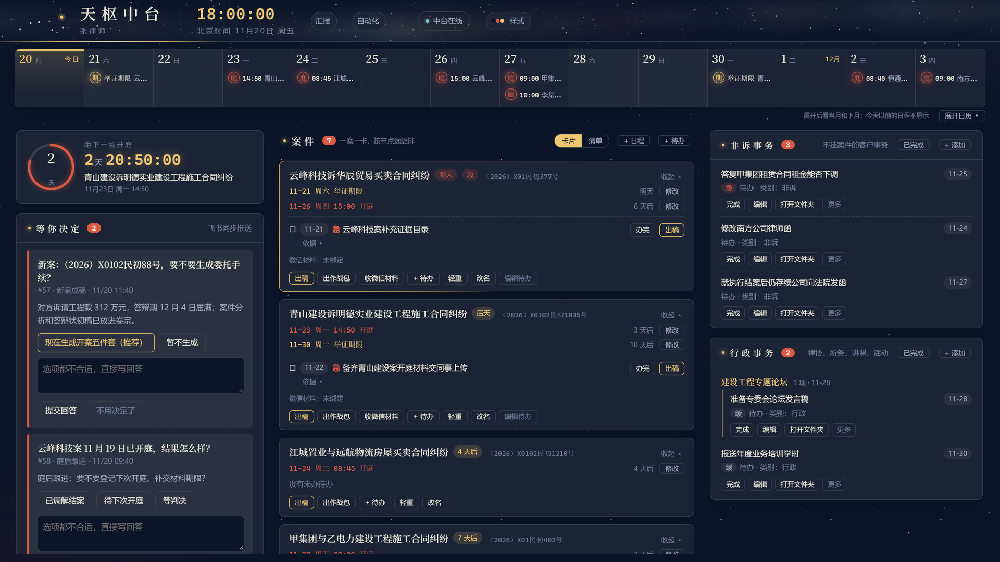
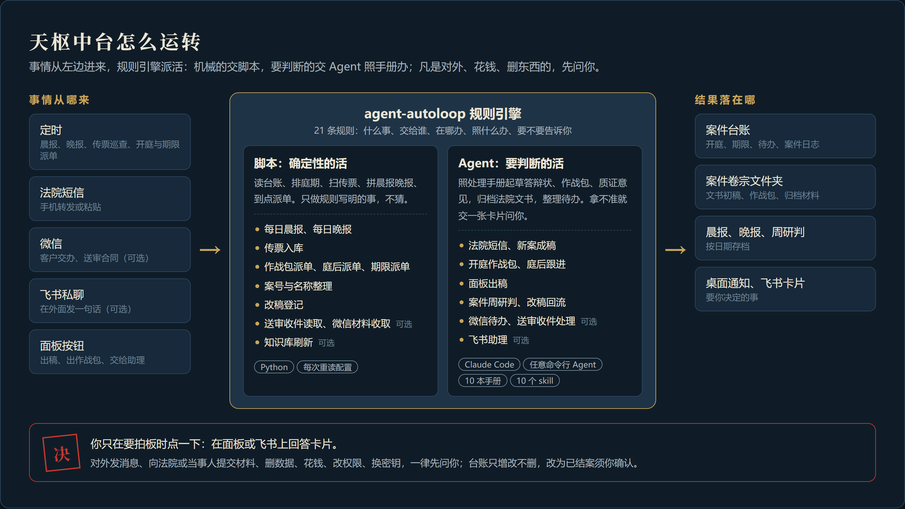
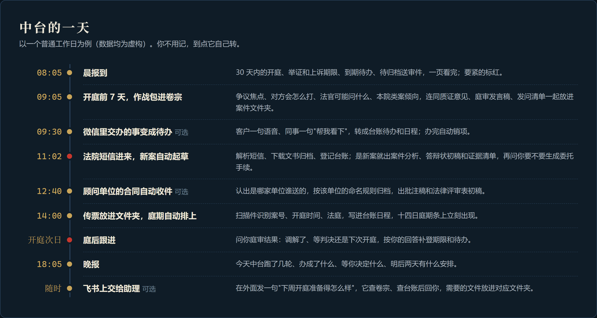

<p align="center">
  
</p>

# 天枢中台

律师的日常杂事在后台自己转，律师只在要拍板时点一下。

天枢中台是一位执业律师自用的工作自动化系统。它跑在 [agent-autoloop](https://github.com/KKKKhazix/agent-autoloop) 规则引擎上：到点或来事件时，确定性的活交给 Python 脚本，要动脑的活交给 Claude Code 按「处理手册」去做，凡是对外发送、提交、删除、花钱的事都先推一张卡片等本人批准。




*截图均使用虚构的演示数据，不含真实客户、案件或账号信息。*

**[完整图文介绍](docs/图文概述/天枢中台概述.md)** · [下载完整源码](https://github.com/kun-lawyer/tianshu-legal-hub/archive/refs/heads/main.zip) · [安装步骤](#安装) · [外部依赖](#外部依赖) · [安全与数据](SECURITY.md)

## 图文导览





庭期与案件卡片、人工确认、送审台、工作日志、自动化规则和安装示例，共 13 张图，见[完整图文介绍](docs/图文概述/天枢中台概述.md)。

## 它每天做什么

| 时间或事件 | 规则 | 做什么 |
|---|---|---|
| 每天 8:05 | 每日晨报 | 汇总 30 天内的开庭、举证和上诉期限、到期待办、待归档送审件，推桌面卡片 |
| 每天 18:05 | 每日晚报 | 当天各规则跑了什么、明后两天的安排、未完成的遗留事项 |
| 每 20 分钟 | 传票入库 | 传票扫描目录有新文件就 OCR，识别案号、开庭时间、法庭，写进案件台账日程 |
| 法院短信 | 法院短信 | 解析短信链接、下载文书、归档到案件文件夹、更新台账；新案交给「新案成稿」 |
| 新案到达 | 新案成稿 | 出案件分析报告、答辩状或起诉状初稿、证据清单，登记台账 |
| 开庭前 7 天 | 作战包派单 → 开庭作战包 | 出庭前作战包（十四部分）、质证意见、庭审发言稿、发问清单；调解中的案子出调解准备单 |
| 开庭后 | 庭后派单 → 庭后跟进 | 问本人庭审情况，更新台账，补后续待办 |
| 期限前 3 天 | 期限派单 → 面板出稿 | 按待办或日程判断要出什么文书、放哪，在案件文件夹里起草 |
| 每天 4 次 | 微信待办 | 把客户、同事在微信里交办的事变成台账待办和日程，办完自动销项（可选模块） |
| 每 30 分钟 | 微信材料收取、送审收件 | 把微信发来的案件材料、顾问单位送审合同收进对应文件夹，出批注稿和法律评审表初稿（可选模块） |
| 飞书私聊 | 飞书助理 | 在手机上发一句话交给助理，结果存进对应文件夹并回复（可选模块） |
| 每周日 | 案件周研判、改稿回流 | 周研判：挑出临期、停滞的案件写简报。改稿回流：对比系统初稿和本人改定稿，提炼写作规则回写手册 |
| 每天凌晨 | 知识库刷新 | 调用本人知识库的刷新脚本（可选） |

本机网页面板（`面板/`）把庭期日历、待办、送审台、日报和各规则状态放在一屏，可以回答卡片、改待办和日程、派活给助理。

## 架构

```
  定时 / 法院短信 / 微信 / 飞书 / 面板按钮
                    │ 事件
                    ▼
        agent-autoloop 中台（rules.json）
          │                         │
     脚本/*.py                Claude Code + 手册/*.md
    （确定性处理）              （判断、起草、归档）
          │                         │
          ▼                         ▼
   案件台账（台账接口）、资料目录、桌面通知、飞书卡片
                    │
                    ▼
        本人：在面板或飞书上拍板
```

## 目录

```
脚本/        Python 脚本；cfg.py 统一读配置，ledger.py 是案件台账后端的读写工具
手册/        每条 Agent 规则照着做的处理手册；作战包范例/ 是虚构的格式骨架
skills/      随仓库提供的 10 个 skill（见下表）
面板/        本机网页面板（server.py 只监听 127.0.0.1）
示例/        顾问单位参数和送审收件规则的示例
工具/        安装向导、发布前的敏感信息扫描
安装.cmd / install.ps1   一键安装入口
config.example.json      本机配置模板（安装向导会据此生成 config.json）
rules.example.json       agent-autoloop 规则模板（21 条）
AGENTS.md                给 Agent 的工作须知（任何 Agent 通用）；CLAUDE.md 只是引用它
SKILL.md                 天枢中台本身作为一个 skill：教 Agent 安装、配置、管规则、排错（含 SkillHub 发布元数据）
```

## 安装

需要 Windows 10/11、可用的命令行 Agent，以及兼容的案件台账后端或自行实现的适配器。云端模型和外部服务的账号、费用由使用者自行承担。先下载并解压完整仓库，再双击 **`安装.cmd`**，按提示回答即可。安装向导会：

1. 检查 Python 3.10+、Node.js 24+、Git，缺哪个就问您是否用 winget 安装；
2. 在仓库里建 `.venv` 虚拟环境，装好 `requirements.txt` 里的 Python 依赖；
3. 问您的姓名、资料目录、要开哪些模块，生成 `config.json`；
4. 填案件台账后端的地址和账号，当场试登录（凭据只存在本机 `~/.tianshu-ledger/`）；
5. 选用哪个 Agent 干活（见下节）；
6. 没装规则引擎的，从 GitHub 下载 agent-autoloop 官方安装脚本装好；
7. 把 `skills/` 装到 Agent 的 skill 目录，已有同名的先问再覆盖，覆盖前备份；
8. 问是否装本机语音转写 FunASR：同意就建独立环境 `~/.funasr-local`，装依赖、下模型（约 2 至 3 GB）并自检；
9. 问扫描件识别 MinerU 怎么用：自动检测 NVIDIA 显卡和驱动支持的 CUDA 版本，有显卡默认本机识别（独立环境 `~/.mineru-local`，自动换装匹配的 CUDA 版 PyTorch，模型约 4.6 GB 在首次识别时下载），没显卡默认云端识别；两种都可填 MinerU 云端 Token 作回落；
10. 选了飞书的：装 lark-cli、绑定飞书应用、发一句话自动取您的 open_id、注册开机自启的收消息程序；
11. 把规则合并进 `~/.agent-autoloop/rules.json`（原文件先备份，校验不过自动恢复），没开的模块对应的规则不装；
12. 在桌面放面板快捷方式，最后自检：读一次台账、出一份晨报。

每一步都能跳过，装完想改可以随时重跑 `安装.cmd`。批量部署时可用应答文件预填全部提问：`.\install.ps1 --answers 应答.json`（键名见 `工具/安装.py` 里各 `ask` 调用）。

周研判要一份在办案件清单：运行 `.venv\Scripts\python 脚本\在办判断.py` 生成 `在办案件初判（新）.xlsx`，复核「在办」一列后另存为 `在办案件勾选清单.xlsx`。

## 用哪个 Agent

规则引擎把要动脑的活交给一个命令行 Agent。安装时二选一：

- **Claude Code**：skill 装到 `~/.claude/skills/`，项目须知由 `CLAUDE.md` 引用 `AGENTS.md`。
- **任何其他命令行 Agent**（opencode、Kimi CLI、Gemini CLI、Codex 等）：填一条命令模板，用 `{prompt}` 代表交给它的指令，例如 `opencode run {prompt}`。这类工具直接读仓库 `skills/<名字>/SKILL.md` 照做（`AGENTS.md` 已写明），不需要安装 skill；工具有自己的 skill 目录的，安装时填上可一并复制。

手册和 `AGENTS.md` 只写「做什么」，不依赖某一家工具的专有功能。无人值守时 Agent 没人批准命令，各家工具的权限请照 `AGENTS.md` 第一节放开读写文件和运行 `python`；Claude Code 的放行清单已写在 `.claude/settings.json`。

## 随仓库提供的 skill

| skill | 用途 | 来源 |
|---|---|---|
| court-sms | 解析法院短信，下载、归档文书 | 改自 cat-xierluo/legal-skills（MIT） |
| mineru-ocr | 扫描件转 Markdown：本机 MinerU 优先，云端回落 | 改自 cat-xierluo/legal-skills（MIT） |
| funasr-transcribe | 本机 FunASR 语音转文字 | 改自 cat-xierluo/legal-skills（MIT） |
| contract-review | 在合同副本上加实质性批注 | 部分文件来自 duhu2000/legal-assistant-skills（Apache-2.0） |
| case-analyzer | 接案初评、争点、策略、案件简报，一次只跑一个模式 | 本项目 |
| case-intake-kit | 新收案件一条龙：下载文书、生成开案五件套 | 本项目 |
| claim-chart | 法律要件对照表，证据缺口标红 | 本项目 |
| evidence-organizer | 证据目录、质证意见、证据强度三档 | 本项目 |
| judgment-analyzer | 裁判文书分析：要旨、论理、附带说理分开 | 本项目 |
| gongwen-format | docx 按公文格式排版 | 本项目 |

各 skill 目录里的 `LICENSE*` 与 `NOTICE.md` 写明来源和改动。手册另外会用到 guwen-review、law-opinion-writer、litigation-doc-generator 三个不随仓库提供的 skill，没有时按 `AGENTS.md` 里的替代做法处理。

## 外部依赖

**案件台账后端。** `脚本/ledger.py` 适配的是一个案件管理系统的 HTTP 接口（登录、案件、日程、任务、案件日志）。用别的系统时，照 `ledger.py` 的命令行用法另写一个同名适配器即可，其他脚本只通过它读写台账。

**可选组件。** 程序和模型体积大，不放进仓库，由安装向导按需下载到独立环境：

| 模块 | 依赖 | 怎么装 | 开关 |
|---|---|---|---|
| 飞书 | lark-cli、飞书自建应用 | 安装向导 | `飞书.启用` |
| 扫描件识别 | MinerU 4 本机服务（模型约 4.6 GB，有 NVIDIA 显卡才快），或 MinerU 云端 Token | 安装向导；手动见 `skills/mineru-ocr/SKILL.md` | `工具.mineru_convert` |
| 语音转写 | FunASR 本机服务（依赖加模型约 2 至 3 GB，CPU 即可） | 安装向导；手动见 `skills/funasr-transcribe/SKILL.md` | `工具.funasr`、`工具.funasr_python` |
| 微信 | 微信 PC 4.x；WeChatDataAnalysis 导出的数据库密钥；语音另需 wechat-archive skill 的 silk 解码脚本 | 自备 | `微信.启用` |
| 顾问单位送审 | guwen-review skill 的 `wechat_inbox.py`；`示例/` 格式的单位参数 | 自备 | `顾问单位.启用` |

可选模块未启用时，对应脚本打印一行提示后正常退出，安装向导也不会装它们的规则。

## 安全

程序、配置和本地产物保存在本机，面板只监听回环地址；云端 Agent、远程台账、云端 OCR 和飞书等启用后会向对应服务传输相关数据。案件台账不删记录，对外动作一律先问本人。微信模块只读本人账号，使用前请确认符合所在单位制度和相关法律法规。详见 [SECURITY.md](SECURITY.md)。

提交代码前跑 `python 工具/敏感词扫描.py <词表>`，词表放仓库外。

## 许可

本仓库自有部分为 [MIT](LICENSE)。`skills/` 下来自第三方的文件继续适用其原许可，见各目录的 `LICENSE*` 与 `NOTICE.md`。

## 致谢

天枢中台建立在开源社区已有成果之上。特别感谢**卡兹克**与**杨卫薪律师**开放分享自己的工具和实践，使本项目能够在此基础上做面向律师日常工作的整合与适配。

| 作者或团队 | 项目 | 本项目使用或参考的内容 |
|---|---|---|
| **卡兹克（数字生命卡兹克 / KKKKhazix）**及贡献者 | [agent-autoloop](https://github.com/KKKKhazix/agent-autoloop) | 中台使用的规则引擎，负责事件触发、任务调度和人工确认。按 MIT 许可使用，安装时从上游获取。 |
| **杨卫薪律师（cat-xierluo）**及贡献者 | [legal-skills](https://github.com/cat-xierluo/legal-skills) | 法院短信 `court-sms`、扫描件识别 `legal-ocr`、本地语音识别 `local-asr` 是本仓库对应三个技能的上游来源；本项目做了 Windows、本地服务和中台流程适配。所引用的三个技能保留各自 MIT 许可及改动说明。 |
| **JiCheng、zh-xx、duhu2000**及相关贡献者 | [legal-assistant-skills 原项目](https://github.com/zh-xx/legal-assistant-skills)、[企查查 MCP 集成分支](https://github.com/duhu2000/legal-assistant-skills) | 合同审查技能的部分脚本与参考文档。沿用 Apache-2.0 许可，来源、文件范围和本地改动见 [NOTICE](skills/contract-review/NOTICE.md)。 |
| **法穿团队（Lawyer-ray）** | [FachuanHybridSystem](https://github.com/Lawyer-ray/FachuanHybridSystem) | 法院短信技能所参考的短信解析、案件匹配及文书下载流程。具体参考范围与实现差异见[归属声明](skills/court-sms/references/ATTRIBUTION.md)，该项目不纳入本仓库的 MIT 授权范围。 |
| **MinerU、FunASR 开源团队**及贡献者 | [MinerU](https://github.com/opendatalab/MinerU)、[FunASR](https://github.com/modelscope/FunASR) | 提供文档解析和语音识别能力；程序与模型按需安装，不随本仓库分发，分别遵循上游许可。 |

感谢所有上游作者、维护者和贡献者。使用或再分发本项目时，请一并保留相关版权声明、许可证和来源说明。
