# 天枢中台：律师只在拍板时出手

> 律师的日常杂事在后台自己转，律师只在要拍板时点一下。

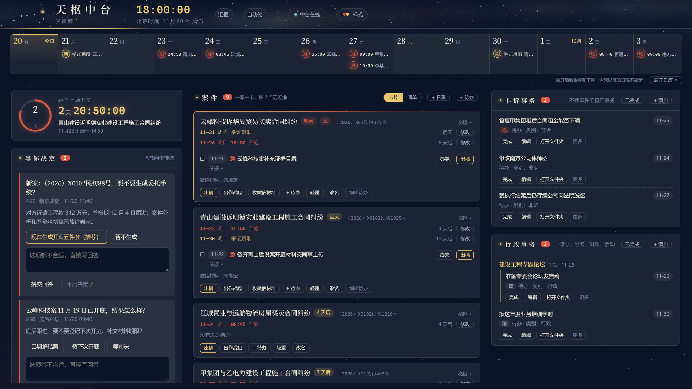

*面板全景：十四日庭期、等你决定、案件卡片、非诉与行政事务一屏看完。本文所有截图均为演示数据，人名、单位、案号全部虚构。*

## 它是什么

天枢中台是一位执业律师给自己做的工作自动化系统，现已开源。它不替律师做判断，只把重复、琐碎、靠记性的事接过去：盯开庭和期限、收传票和法院短信、整理微信里交办的事、开庭前备材料、每天早晚各汇报一次。

它跑在开源规则引擎 agent-autoloop 上。到点或来事件时，机械的活交给 Python 脚本，要动脑的活交给 Agent（Claude Code 或任何命令行 Agent）按「处理手册」去办。凡是对外发送、向法院提交、删除数据、花钱的事，一律先推一张卡片问律师本人。程序和本地产物保存在本机；启用云端 Agent、远程台账、OCR 或飞书时，相关内容会传给对应服务。

## 怎么运转

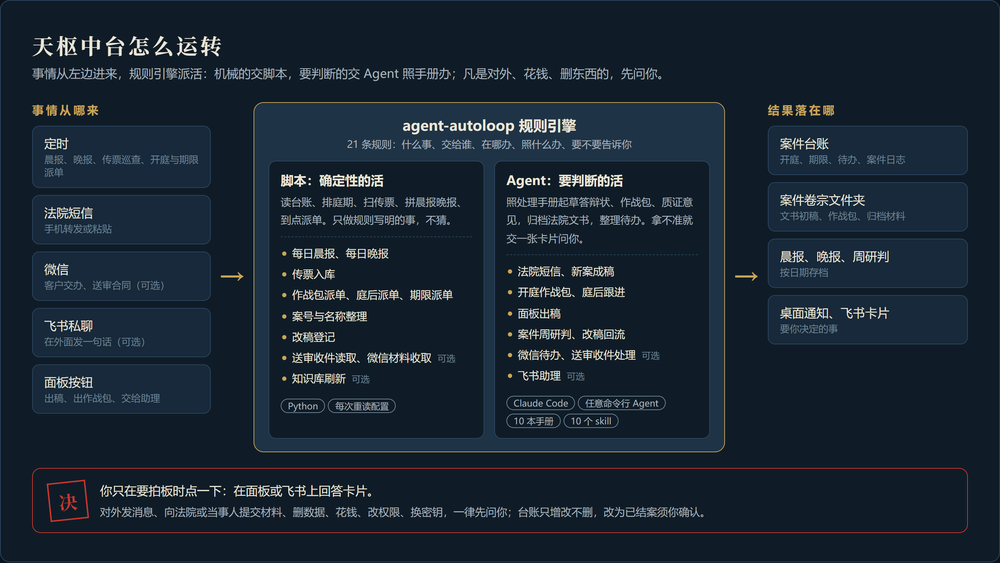

- **事情从哪来**：定时任务、法院短信、微信、飞书私聊、面板上的按钮。
- **谁来办**：21 条规则决定每件事交给谁、在哪个目录办、照哪本手册办、要不要告诉你。确定性的活（读台账、排庭期、拼晨报）由脚本做，需要判断和起草的活由 Agent 照 10 本处理手册做。
- **结果落在哪**：案件台账、案件卷宗文件夹、晨报晚报，需要你决定的事推到面板和飞书。

## 中台的一天

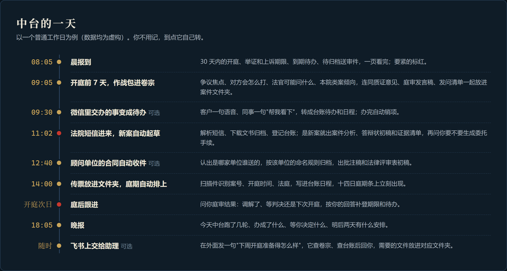

律师不用记任何时间点。早上 8:05 晨报到，开庭前 7 天作战包自动进卷宗，法院短信一到就归档登记，晚上 18:05 晚报总结当天。人在外面，飞书发一句话就能把事交出去。

## 主要功能

### 一、庭期与案件：一案一卡，按节点远近排

面板顶部是未来十四天的庭期条：「庭」是开庭，「期」是举证、上诉等期限。数据来自案件台账，传票扫描件放进指定文件夹后，中台自动识别案号、开庭时间和法庭，写进台账，庭期条上随即出现。

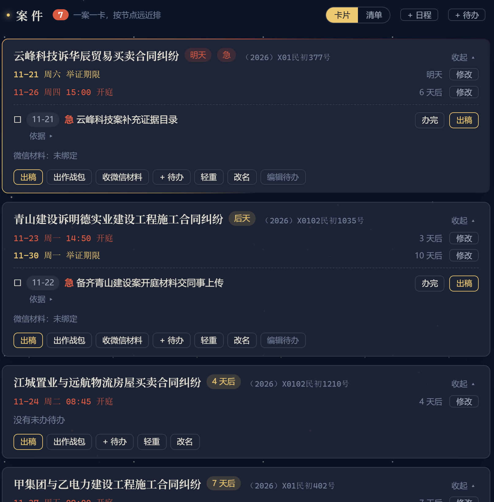

中间一栏按案件聚合：每个案件一张卡，列出开庭、期限和挂在这个案子下的待办，越近越靠前。卡片上可以直接「出稿」「出作战包」「收微信材料」，点一下就交给 Agent 去办。

### 二、等你决定：只在拍板时点一下

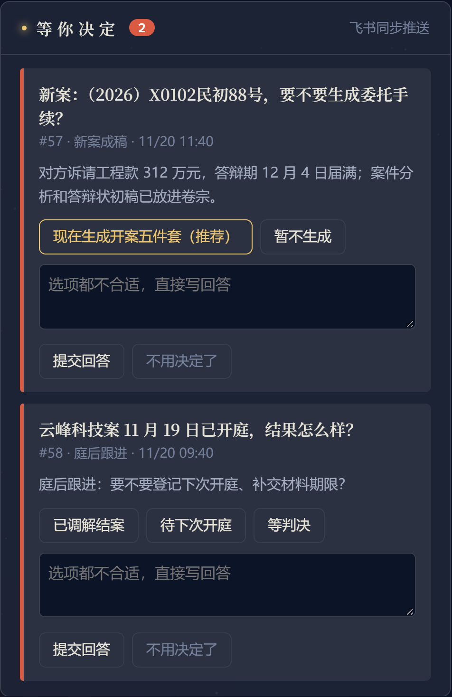

Agent 拿不准、或者事情需要律师本人授权时，不会自作主张，而是推一张卡片：说明情况、给出选项、标出推荐项。面板和飞书同步推送，点一下选项或写一句话回答，中台接着办。

对外发消息、向法院或当事人提交材料、删数据、花钱、改权限、换密钥，这几类事一律先问。案件台账只增改不删，改为已结案必须本人确认。

### 三、开庭作战包：开庭前 7 天进卷宗

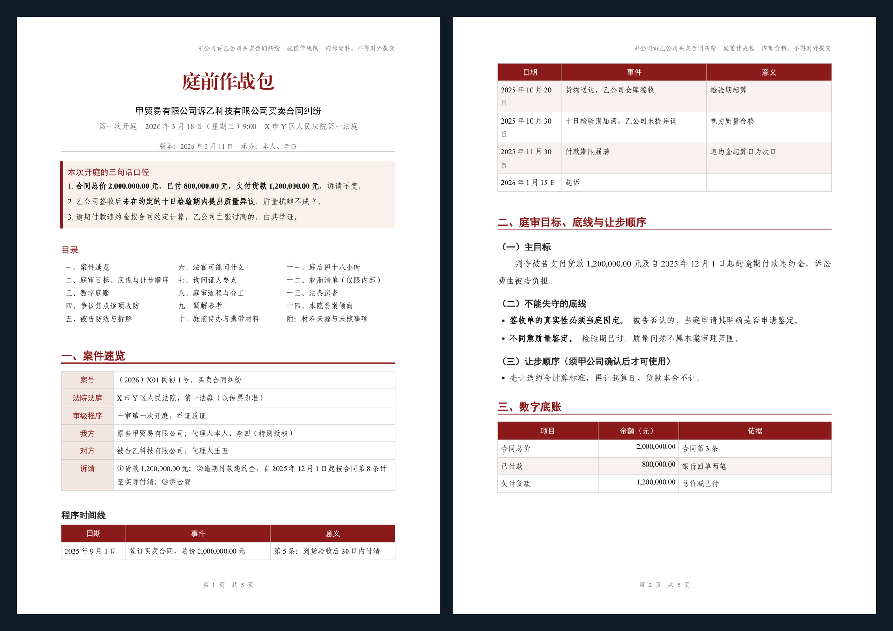

开庭前 7 天，中台自动给这场开庭出一套材料放进案件文件夹：

- **庭前作战包**，十四部分：案件速览、庭审目标与让步顺序、数字底账、争议焦点逐项攻防、被告防线与拆解、法官可能问什么、询问要点、庭审分工、调解参考、庭前待办、庭后四十八小时、软肋清单、法条速查、本院类案倾向；
- 质证意见、庭审发言稿；
- 发问清单三版：提交版、带回答版、自己看版。

案件处于调解中的，改出调解准备单。法条和类案按手册要求现查核对，不凭记忆写。

### 四、法院短信与新案成稿

手机收到法院短信，转发到飞书或在电脑上双击「粘贴法院短信」，中台解析链接、下载文书、归档到案件文件夹、登记台账。是新收的案件，就接着出案件分析报告、答辩状初稿和证据清单，再问你要不要生成委托手续。

### 五、送审台：顾问单位的合同自动收件（可选）

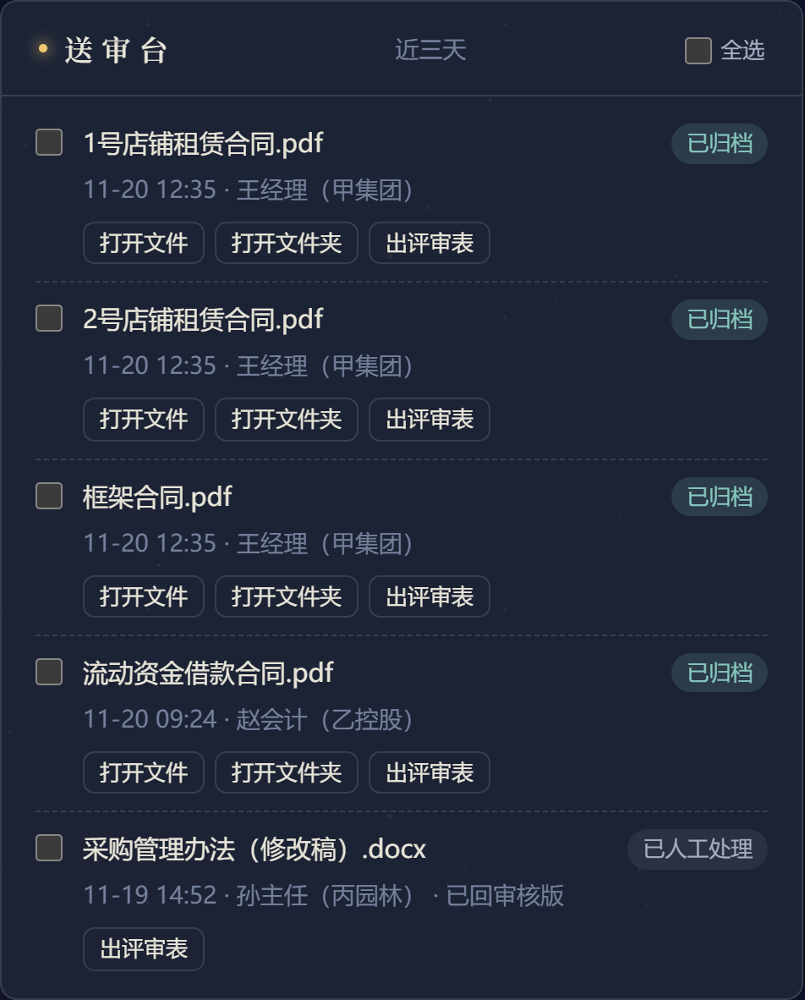

顾问单位在微信上发来的合同，中台认出是哪家单位、谁送的，按该单位的命名规则归档，出批注稿和法律评审表初稿。已人工处理过的不重复出。

### 六、微信待办、非诉与行政事务（可选）

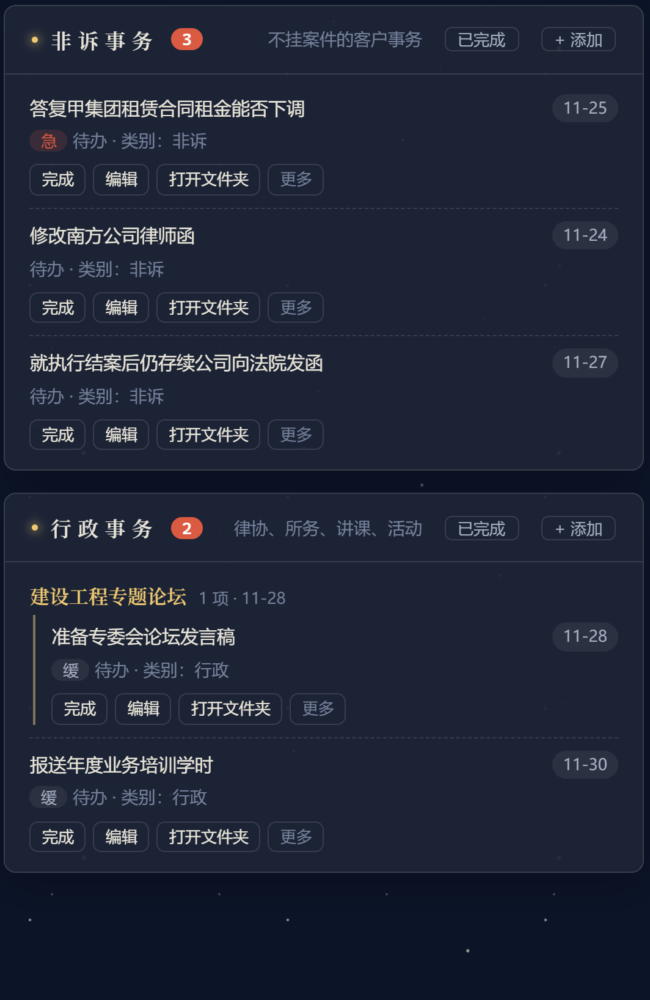

客户一句语音、同事一句「帮我看下」，中台每天四次读一遍微信，把交办的事变成台账里的待办和日程，办完自动销项。不挂案件的事分两栏：给客户办的非诉事务，和律协、讲课、论坛这类行政事务。

### 七、汇报：晨报、晚报、周研判、工作日志

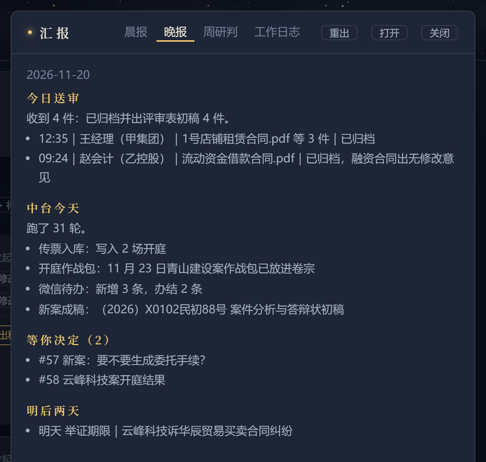

晨报列出 30 天内的开庭、期限和到期待办；晚报总结当天送审、中台办了什么、等你决定什么、明后两天的安排；每周日出一份案件周研判，挑出临期、停滞的案件。

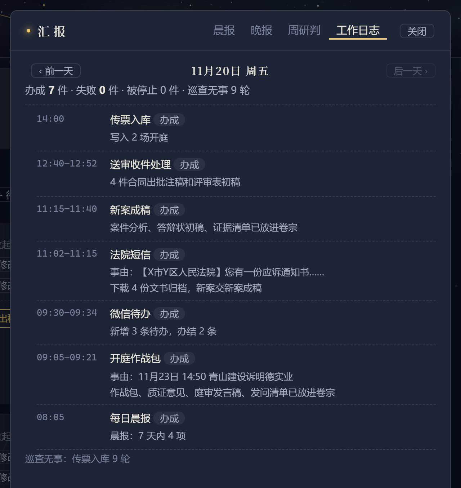

工作日志按天列出中台跑过的每一轮：几点、哪条规则、办成没有、为什么而办。巡查无事的轮次只计数，不刷屏。

### 八、自动化规则

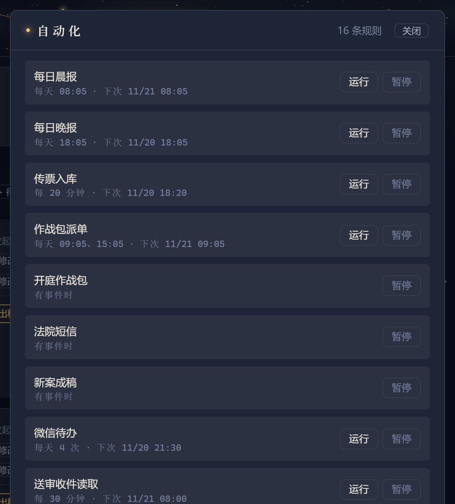

规则模板共 21 条，实际启用数量取决于所选模块，截图展示其中 16 条。面板上可以看下次运行时间，随时手动运行或暂停。没启用的模块（微信、顾问单位、飞书、知识库），安装时就不装对应规则，不会白跑。

## 安全与隐私

- 程序和本地产物保存在本机；面板只监听本机地址，写操作校验来源。云端 Agent、远程台账、云端 OCR 和飞书的数据传输范围见[安全说明](../../SECURITY.md)。
- 对外动作一律先问，台账只增改不删。
- 微信模块只读本人电脑上本人账号的数据，默认关闭。
- 语音转写（FunASR）和扫描件识别（MinerU）支持本机处理。MinerU 默认可能回落云端，保密文件须使用 `--local-only` 或设置 `MINERU_LOCAL_ONLY=1`。

## 安装：双击一个文件

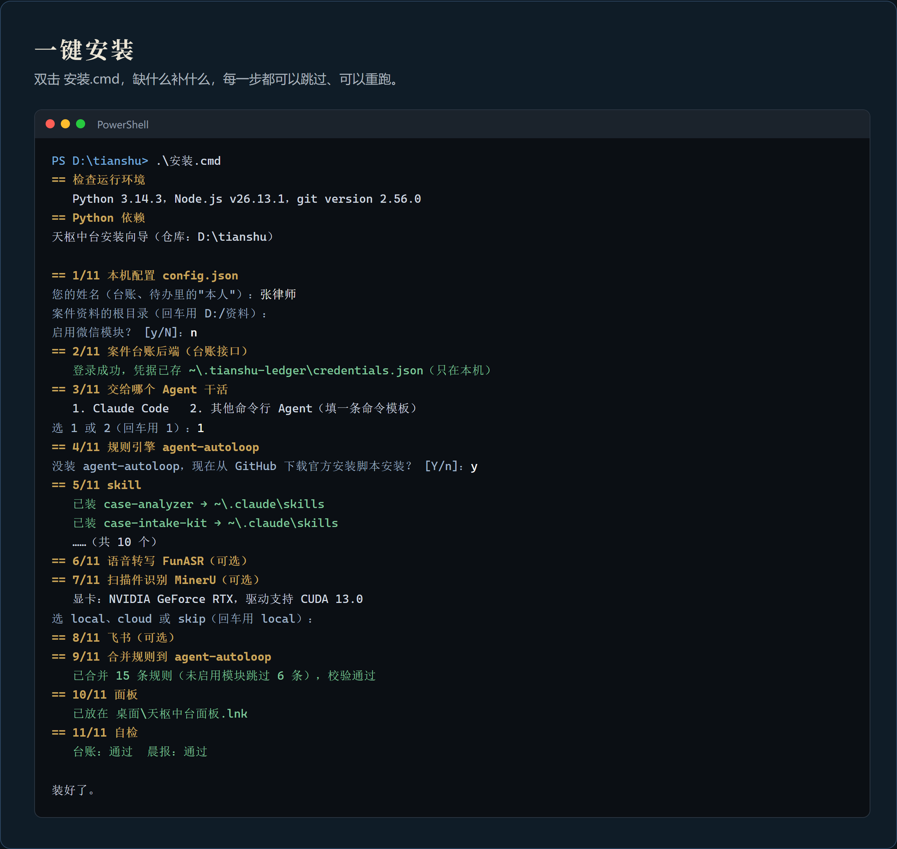

在 Windows 上双击 `安装.cmd`，向导缺什么补什么：Python、Node.js、Git、规则引擎、Python 依赖；然后问你的姓名、资料目录、要开哪些模块，从 GitHub 装好规则引擎，合并规则，在桌面放面板快捷方式，最后自检。每一步都可以跳过、可以重跑，覆盖已有文件前先备份。

**用哪个 Agent**：Claude Code，或填一条命令模板接入任何命令行 Agent（opencode、Kimi CLI、Gemini CLI、Codex 等）。处理手册只写「做什么」，不依赖某一家工具的专有功能。

**随附 10 个 skill**：法院短信下载归档（court-sms）、扫描件识别（mineru-ocr）、语音转写（funasr-transcribe）、合同审查（contract-review）、案件分析（case-analyzer）、新案开案套件（case-intake-kit）、法律要件对照表（claim-chart）、证据整理（evidence-organizer）、裁判文书分析（judgment-analyzer）、公文排版（gongwen-format）。

**需要说明的一点**：案件台账后端适配的是一套案件管理系统的接口。没有同款系统的，照仓库里 `ledger.py` 的命令行用法写一个适配器即可，其他部分不用改。

## 开源信息

- GitHub：[kun-lawyer/tianshu-legal-hub](https://github.com/kun-lawyer/tianshu-legal-hub)。
- 下载：[完整源码 ZIP](https://github.com/kun-lawyer/tianshu-legal-hub/archive/refs/heads/main.zip)，解压后按首页安装说明操作。
- 许可：MIT；随附第三方 skill 保留其原许可（MIT、Apache-2.0）。
- 规则引擎：agent-autoloop（MIT），安装时自动下载。
- 适合谁：每天被开庭、期限、送审和各种交办事项追着跑的执业律师和律所团队。

[返回仓库首页](../../README.md)
